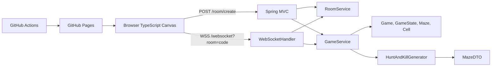
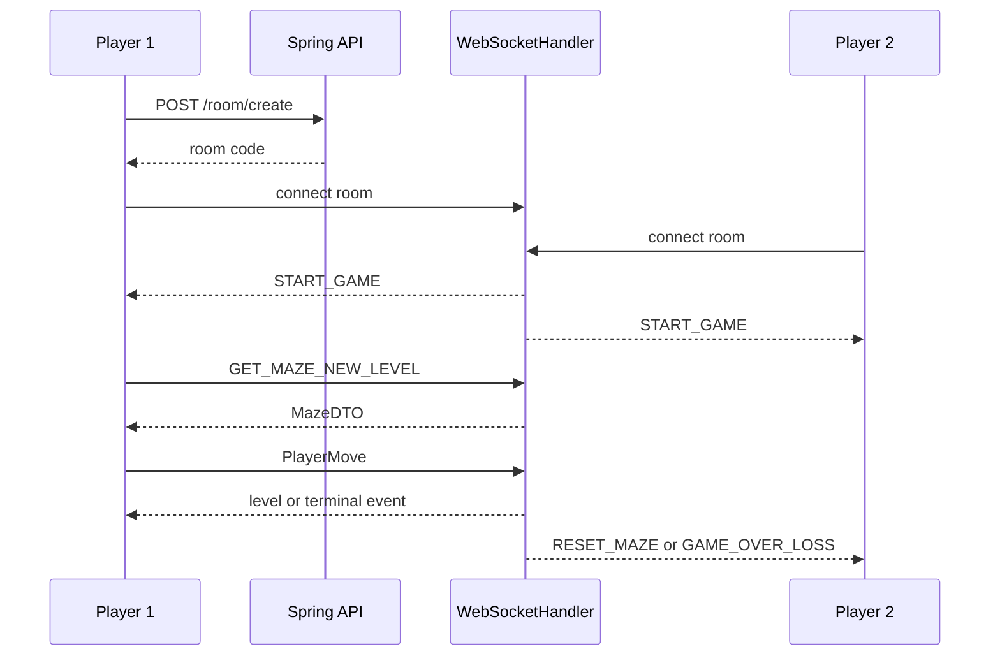

# Moonrift Project Documentation

## Table of Contents

1. [Scope and Evidence](#scope-and-evidence)
2. [Project Overview](#project-overview)
3. [Features and Functionality](#features-and-functionality)
4. [Technology Stack](#technology-stack)
5. [System Architecture](#system-architecture)
6. [Codebase Structure](#codebase-structure)
7. [Technical Implementation](#technical-implementation)
8. [Data and API Design](#data-and-api-design)
9. [End-to-End Workflows](#end-to-end-workflows)
10. [Security, Performance, and Reliability](#security-performance-and-reliability)
11. [Testing, Build, and Deployment](#testing-build-and-deployment)
12. [Engineering Decisions and Challenges](#engineering-decisions-and-challenges)
13. [Limitations and Future Improvements](#limitations-and-future-improvements)
14. [Resume and Interview Preparation](#resume-and-interview-preparation)

## Scope and Evidence

This documentation is based on the inspected `main` branch of `mrudulpatil18/moon-rift`, including Java source, TypeScript source, HTML, Maven/npm configuration, Docker, tests, and GitHub Actions. No undocumented production metrics, database, authentication system, or feature is assumed.

## Project Overview

Moonrift is a browser-based, two-player competitive maze game. One player creates a room and shares a short code; another joins; both solve mazes generated by the backend. The Spring Boot server provides room allocation, two-player admission, independent player state, server-side move validation, level progression, and win/loss coordination. The target users are casual players, friends, and portfolio/demo reviewers. Accounts, matchmaking, chat, persistent scores, and a lobby are not implemented.

## Features and Functionality

`ui/src/script.ts#createRoom()` creates or joins a room, copies created codes to the clipboard, and opens `wss://mazerunner-ynnb.onrender.com/websocket?room=<code>`. `RoomService` stores room codes in a process-local `ConcurrentHashMap`, generates five-character UUID prefixes, and checks validity. `WebSocketHandler.afterConnectionEstablished()` rejects invalid rooms and a third connection.

`GameService` creates a `Game` with two independent `GameState` objects. The second connection broadcasts `START_GAME`. Status messages are `GET_MAZE_NEW_LEVEL` and `GET_MAZE_SAME_LEVEL`; server events are `START_GAME`, `INVALID_MOVE`, `UPDATE_MAZE_LEVEL`, `RESET_MAZE`, `GAME_OVER_WIN`, and `GAME_OVER_LOSS`.

`HuntAndKillGenerator.generateMaze()` performs randomized walking through unvisited orthogonal neighbors, hunts for a connected unvisited cell, and carves bidirectional passages. `getFarthestCellCoordinates()` uses BFS to select the farthest reachable goal. `GameState.level` starts at 5; the first new-level request generates a 6x6 maze and level 12 is the win condition.

The client uses HTML5 Canvas, arrow-key controls, isometric projection, sprite animation, decorative tiles, a star-field background, and a movement animation. `getThickWalledMaze()` converts `MazeDTO` wall matrices to an expanded `2n+1` grid. `Player.makeMove()` performs local exit checks and sends cell-to-cell moves for authoritative server validation.

## Technology Stack

| Area | Technology | Role |
|---|---|---|
| Backend | Java 17, Spring Boot 3.4.2 | Application and domain logic |
| Transport | Spring Web MVC and WebSocket | HTTP endpoints and realtime gameplay |
| Serialization | Jackson `ObjectMapper` | JSON protocol and DTOs |
| Boilerplate | Lombok | Accessors and constructors |
| Frontend | TypeScript 5.7.3, HTML5 Canvas | Client, rendering, input, animation |
| Build | Maven, npm, TypeScript compiler | Packaging and frontend compilation |
| Runtime | Docker `openjdk:17-jdk-slim` | Java application image |
| Delivery | GitHub Actions and GitHub Pages | Static UI deployment |
| Persistence | None | Rooms/games are in memory |

## System Architecture



`RunnerApplication` bootstraps Spring. `CorsConfig` and `WebSocketConfig` allow wildcard origins. `RoomController` creates rooms; `MazeController` exposes standalone maze generation; `WebSocketHandler` translates JSON messages; `RoomService` and `GameService` manage process-local state.



## Codebase Structure

```text
.github/workflows/static.yml
Dockerfile
pom.xml
src/main/java/msp/runner/
  RunnerApplication.java
  config/{CorsConfig,Mappers,WebSocketConfig}.java
  controller/{MazeController,RoomController,WebSocketHandler}.java
  dtos/MazeDTO.java
  generators/{MazeGenerator,HuntAndKillGenerator}.java
  model/{Cell,Coordinate,Edge,Game,GameState,Maze,PlayerMove,PlayerStatus,ServerMessage,Status}.java
  service/{GameService,RoomService}.java
src/main/resources/application.properties
src/test/java/msp/runner/RunnerApplicationTests.java
ui/{package.json,tsconfig.json,public/index.html,src/script.ts}
```

Major entry points include `RunnerApplication.main()`, `RoomController.createRoom()`, `MazeController.getNewMaze()`, `WebSocketHandler.handleTextMessage()`, `GameService.handleMove()`, `GameService.generateNewLevel()`, `GameState.updateState()`, `HuntAndKillGenerator.generateMaze()`, `createRoom()`, `initializeGame()`, `drawMaze()`, and `Player.makeMove()`.

## Technical Implementation

`Maze` owns a `Cell[width][height]`; cells have possible neighbors and carved edges. `MazeDTO` exposes `width`, `height`, start/end coordinates, `wallH`, and `wallV`; `1` means wall and `0` means an open carved passage. The client reconstructs the expanded wall grid.

`GameState.isValidMove()` checks source/destination bounds, verifies that `from` is the current position, and confirms that `to` is a carved edge. Valid moves are stored in a `CopyOnWriteArrayList`. `GameService.handleMove()` returns no event for normal moves, `UPDATE_MAZE_LEVEL` for a non-final goal, and `GAME_OVER_WIN` at level 12.

WebSocket status payloads look like `{"statusMessage":"GET_MAZE_NEW_LEVEL"}`. Move payloads look like `{"from":{"x":2,"y":4},"to":{"x":2,"y":5}}`. Enum events are JSON strings; maze responses are objects. Malformed JSON and missing query data have no dedicated error protocol.

## Data and API Design

| Method | Path | Inputs | Output |
|---|---|---|---|
| POST | `/room/create` | none | Plain-text code, HTTP 201 |
| GET | `/maze` | `dimension`, `roomId` query parameters | `MazeDTO` JSON |
| WebSocket | `/websocket?room=<code>` | room query parameter | text/JSON protocol |

`MazeController` accepts `roomId` but does not use it to access room state. There is no database schema, migration, repository layer, external cache, or persistent score model.

## End-to-End Workflows

Room creation calls `RoomService.createRoom()` and `GameService.addGame()`. Two WebSocket sessions call `GameService.addPlayer()` and receive `START_GAME`. Clients request mazes, render them, and submit moves. A non-final solve sends `UPDATE_MAZE_LEVEL` to the solver and `RESET_MAZE` to the opponent. A level-12 solve sends win/loss events. A normal disconnect removes the room, sends literal `Opponent Left`, and closes the other session.

## Security, Performance, and Reliability

Server-side move validation protects game integrity. However, HTTP and WebSocket origins are wildcard-enabled; there is no authentication, authorization beyond possession of a short code, rate limiting, payload limit, abuse detection, or structured protocol error handling. Console logs include room codes and move payloads. The client hard-codes its server URL.

Maze generation, BFS, and DTO construction are in memory and proportional to maze cells. Rendering uses `requestAnimationFrame`. Process-local maps imply a single backend instance; horizontal scaling requires shared state or sticky routing, and restart loses active games. Room timestamps are stored but never used for expiration, and session cleanup is incomplete.

## Testing, Build, and Deployment

The only committed test is `RunnerApplicationTests.contextLoads()`, which checks Spring context startup. It does not cover WebSockets, generation, movement, progression, disconnects, or frontend rendering.

`pom.xml` uses Java 17, Spring Boot 3.4.2, Web, WebSocket, Test, and Lombok. `ui/package.json` defines `npm run build`, `npm run type`, and `npm run watch`; `ui/tsconfig.json` enables strict ES6 TypeScript compilation. `Dockerfile` packages `target/*.jar` into an OpenJDK 17 image. `.github/workflows/static.yml` deploys `ui/dist` to GitHub Pages but does not build it or run tests.

## Engineering Decisions and Challenges

The project uses native WebSockets for an explicit lightweight protocol, server authority combined with client-side animation for responsiveness, a graph-to-wall-matrix DTO for rendering, BFS farthest-goal selection for meaningful maze endpoints, and in-memory state for demo simplicity. These choices reduce infrastructure but limit reconciliation, persistence, observability, and horizontal scaling.

## Limitations and Future Improvements

Add unit and WebSocket integration tests; expire and clean rooms; make connection/session transitions atomic; replace wildcard origins; add authentication or stronger expiring room tokens; add rate limits and structured errors; externalize the server URL; add deterministic maze seeds; reconcile rejected client moves; add reconnect/opponent-left UI; add structured logging, metrics, tracing, health checks, and CI builds; and build the frontend in CI rather than relying on a pre-existing artifact.

## Resume and Interview Preparation

### Resume bullet candidates

- Built a real-time two-player browser maze game using Spring Boot WebSockets, Java 17, TypeScript, and HTML5 Canvas.
- Implemented server-authoritative movement validation with bounds, current-position, and carved-edge checks.
- Developed a randomized Hunt-and-Kill maze generator with bidirectional carving and BFS farthest-goal selection.
- Designed a `MazeDTO` wall-matrix protocol and client expanded-grid conversion for isometric rendering.
- Implemented keyboard movement, camera scaling, sprite animation, tile rendering, and animated star-field effects.
- Coordinated room admission, independent player state, level progression, reset events, and win/loss broadcasts.
- Packaged the Java service with Maven/Docker and configured GitHub Pages deployment through GitHub Actions.

### Interview questions and answer outlines

1. **How does a room become playable?** Room creation creates a code and `Game`; two WebSockets trigger `START_GAME`.
2. **How is a move validated?** Bounds, current source, and carved adjacency are checked in `GameState`.
3. **Why independent states?** Each player progresses independently while the room coordinates competition.
4. **How does Hunt-and-Kill work?** Random walk, hunt-and-connect, then BFS goal selection.
5. **How are walls serialized?** `MazeDTO` sends horizontal/vertical matrices; the client expands them.
6. **What happens after a non-final solve?** Solver gets `UPDATE_MAZE_LEVEL`; opponent gets `RESET_MAZE`.
7. **What limits scaling?** Process-local rooms and games require shared state or sticky routing.
8. **What are security gaps?** Wildcard origins, no authentication, short codes, and no rate limits.
9. **How would you test it?** Unit-test generation/validation and two-session WebSocket integration tests.
10. **How would you improve deployment?** Build UI in CI, run tests, externalize config, and add observability.

### 30-second explanation

Moonrift is a real-time two-player maze game. A Spring Boot backend creates rooms, accepts two WebSocket clients, generates Hunt-and-Kill mazes, validates movement server-side, and broadcasts progression and win/loss events. A strict TypeScript Canvas client renders isometric mazes with keyboard controls and sprite animation.

### 2-minute explanation

Moonrift uses a competitive room-code loop. `RoomService` and `GameService` manage process-local state; `WebSocketHandler` assigns two sessions and coordinates JSON status and move messages. Each player owns a `GameState`. The Hunt-and-Kill generator creates connected mazes, BFS selects the farthest goal, and `MazeDTO` converts the graph into wall matrices for the client. The TypeScript renderer expands those matrices, animates local movement, and sends cell-to-cell moves. The server validates every move and coordinates level resets or terminal win/loss events. The implementation is lightweight but lacks persistence, authentication, comprehensive tests, observability, and multi-instance coordination.