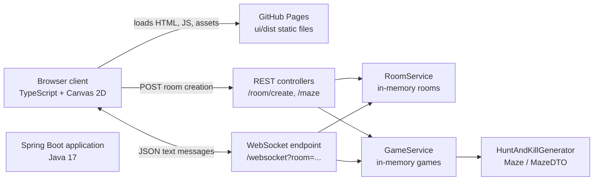
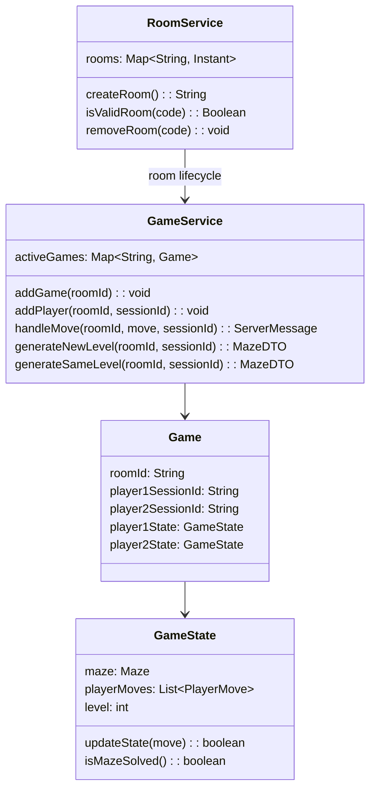
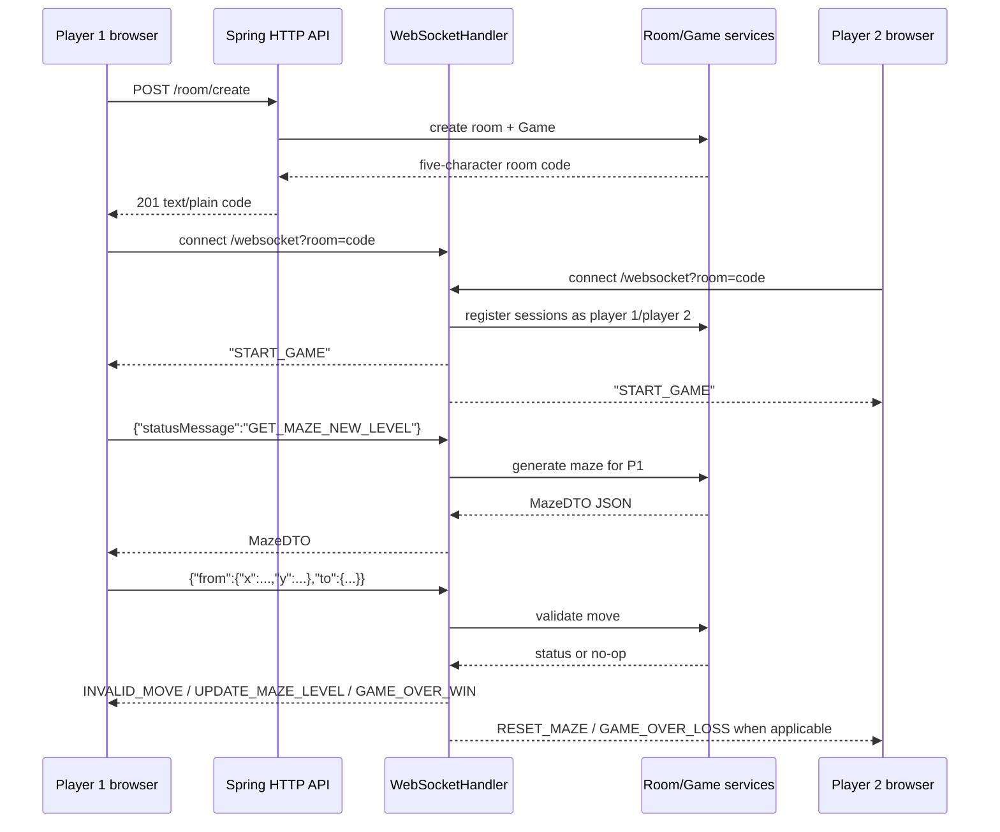
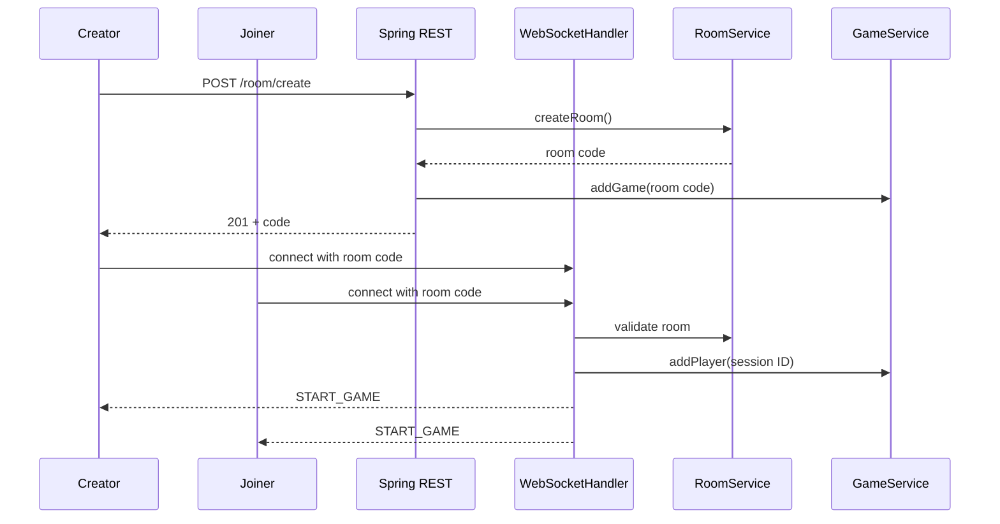
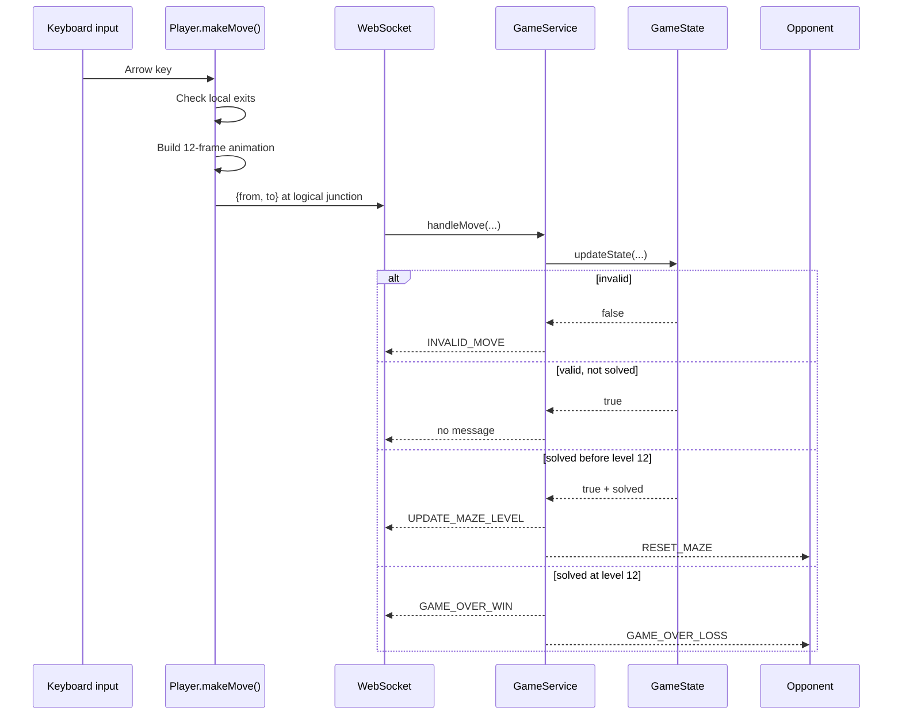

# Moonrift — Comprehensive Project Documentation

> **Repository snapshot:** `main` at commit `4312a2bc2db5bb160a455f18b1280af1531660b5`  
> **Scope:** This document describes the implementation present in this repository. Implemented behavior is distinguished from inferred deployment intent and unknown production behavior.

## Table of Contents

1. [Project Overview](#1-project-overview)
2. [Features and Functionality](#2-features-and-functionality)
3. [Technology Stack](#3-technology-stack)
4. [System Architecture](#4-system-architecture)
5. [Codebase Structure](#5-codebase-structure)
6. [Technical Implementation](#6-technical-implementation)
7. [Data and API Design](#7-data-and-api-design)
8. [End-to-End Workflows](#8-end-to-end-workflows)
9. [UI and Rendering Implementation](#9-ui-and-rendering-implementation)
10. [Security, Performance, and Reliability](#10-security-performance-and-reliability)
11. [Testing and Deployment](#11-testing-and-deployment)
12. [Engineering Decisions and Challenges](#12-engineering-decisions-and-challenges)
13. [Limitations and Future Improvements](#13-limitations-and-future-improvements)
14. [Resume and Interview Preparation](#14-resume-and-interview-preparation)

---

## 1. Project Overview

### 1.1 Product purpose

Moonrift is a browser-based, two-player cooperative/competitive maze game. One player creates a room and shares a short room code; a second player joins using that code. Once both WebSocket clients are connected, each player receives a maze and navigates an isometric pixel-art world with the keyboard.

The backend generates maze topology and validates movement. The frontend turns that topology into a visual game board, animates the player character, and coordinates the room/game protocol over HTTP and WebSocket connections.

### 1.2 Problem statement

The project addresses the problem of making a small multiplayer game playable without accounts, matchmaking infrastructure, or a persistent database. A room-code model provides a lightweight way for two people to enter the same game session, while WebSockets provide low-latency event delivery for game state transitions.

### 1.3 Product vision and value proposition

The visible product direction is a compact, visually distinctive multiplayer experience:

- **Low-friction entry:** no registration or login; create or enter a room code.
- **Immediate gameplay:** the browser renders the game from a maze payload and accepts arrow-key input.
- **Authoritative rules:** the server validates moves rather than trusting only client-side collision checks.
- **Replayable progression:** solving a maze increases the player’s level until the final level.
- **Pixel-art presentation:** a full-screen canvas, sprite sheets, isometric tiles, animated background, themed dialogs, and responsive layout create a game-like interface.

There is no evidence of accounts, persistent player profiles, leaderboards, monetization, or a general-purpose application UI.

### 1.4 Target users and use cases

| User | Use case |
|---|---|
| Player 1 | Create a room, share the generated code, wait for a second player, and solve mazes. |
| Player 2 | Enter an existing room code and join the same two-player session. |
| Developer | Run the Spring Boot server locally, build the TypeScript client, or package the backend as a Docker image. |
| Maintainer | Deploy the committed static client to GitHub Pages and deploy the backend separately. |

### 1.5 Implemented, inferred, and unknown behavior

| Classification | Details |
|---|---|
| **Implemented** | Room creation, room-code joining, two WebSocket sessions per room, maze generation, server-side move validation, level progression, win/loss messages, canvas rendering, keyboard movement, static frontend deployment workflow. |
| **Partially implemented** | A REST `/maze` endpoint exists but is not used by the current frontend; camera drag/zoom handlers exist but their event registrations are commented out; generated frontend assets are not fully reproducible from `ui/public`. |
| **Inferred** | `mazerunner-ynnb.onrender.com` is intended to host the backend used by the published frontend. |
| **Unknown** | Whether the external Render deployment is currently reachable or matches this repository; whether the committed `ui/dist` exactly matches the current TypeScript source in production. |

---

## 2. Features and Functionality

### 2.1 Create a room

The **Create Room** button in `ui/public/index.html` invokes `startRunner()` in `ui/src/script.ts`.

The client:

1. Sends `POST https://mazerunner-ynnb.onrender.com/room/create`.
2. Reads the response as plain text.
3. Copies the returned room code to the clipboard.
4. Displays the code in `#roomcode`.
5. Opens `wss://mazerunner-ynnb.onrender.com/websocket?room=<room-code>`.
6. Displays a waiting dialog until a second client joins.

The backend creates a five-character room identifier from a UUID prefix in `RoomService.createRoom()`, stores it in a `ConcurrentHashMap`, and creates the corresponding `Game` through `GameService.addGame()`.

**Edge cases implemented:**

- A failed HTTP response is logged and the client stops the create flow.
- A room code collision is avoided by regenerating until the code is not already in memory.
- The room exists only in the running process; restarting the server loses it.

### 2.2 Join a room

The **Join Room** button reveals the `#join-form`. On submission, the client takes the input value and calls `startRunner(roomCode)` without first making a REST request.

The client opens a WebSocket using the supplied code. The server validates the code in `WebSocketHandler.getRoomFromSessionUrl()` through `RoomService.isValidRoom()`.

**Failure behavior:**

- Invalid or unavailable rooms are rejected by the server.
- If the WebSocket closes before the game initializes, the client displays the close reason or `"Connection failed. Please check the room code."`.
- The UI’s Back/Cancel buttons reload the page rather than performing a local state reset.

### 2.3 Two-player room admission

`WebSocketHandler.afterConnectionEstablished()`:

- Extracts the `room` query parameter.
- Rejects a missing or invalid room with `CloseStatus.NOT_ACCEPTABLE`.
- Rejects a third active connection when two sessions are already registered.
- Adds the session to the room set.
- Assigns the first session to `Game.player1SessionId` and the second to `Game.player2SessionId`.
- Broadcasts the serialized `ServerMessage.START_GAME` value once two sessions exist.

The room is therefore a fixed-capacity, two-client session rather than a general lobby.

### 2.4 Maze generation

Mazes are generated by `HuntAndKillGenerator`, the current implementation of the `MazeGenerator` interface.

The algorithm:

1. Creates a rectangular grid of `Cell` objects.
2. Builds orthogonal neighbor lists.
3. Chooses a random start cell unless a start coordinate is supplied.
4. Performs a random walk through unvisited neighbors, carving bidirectional edges.
5. When the walk reaches a dead end, hunts for an unvisited cell adjacent to a visited cell.
6. Connects the hunted cell to a random visited neighbor.
7. Repeats until all cells are visited.
8. Runs breadth-first search from the start cell and chooses the farthest reachable cell as the end.

The generated maze is represented as a graph embedded in a rectangular grid. A carved passage is stored on both participating cells.

### 2.5 Maze level progression

Each `GameState` starts at level/dimension `5`.

- `GET_MAZE_NEW_LEVEL` increments the player’s dimension by one and generates a new maze.
- `GET_MAZE_SAME_LEVEL` regenerates a maze using the current dimension.
- Solving a maze below level 12 returns `UPDATE_MAZE_LEVEL`.
- Solving level 12 returns `GAME_OVER_WIN`.
- The opponent receives `RESET_MAZE` after the winner advances.
- The opponent receives `GAME_OVER_LOSS` after the final win.

The player’s prior position is used as the next maze’s requested start coordinate when available. Because the new maze dimensions grow while the previous position may no longer fit, this behavior depends on the coordinate remaining valid.

### 2.6 Server-authoritative movement

The browser performs local exit checks for responsive input, but the server remains authoritative.

`GameState.updateState(PlayerMove)` accepts a move only when:

- `from` is within maze bounds.
- `to` is within maze bounds.
- `from` equals the server’s current position.
- The current cell has a carved edge to `to`.

Valid moves are appended to a `CopyOnWriteArrayList<PlayerMove>`. Invalid moves produce `ServerMessage.INVALID_MOVE`.

Ordinary valid moves do not produce a response. Only invalid moves, level completion, or game completion cause protocol messages.

### 2.7 Win/loss presentation

When the server emits `GAME_OVER_WIN` or `GAME_OVER_LOSS`, the client:

- Stops accepting movement by setting `canMove = false`.
- Shows the `#result` dialog.
- Renders either “YOU WON!” or “YOU LOST!”.

The result dialog’s Close button is wired through the shared `.reload` handler and reloads the entire page.

### 2.8 Disconnect handling

When a connected client closes:

1. `WebSocketHandler.afterConnectionClosed()` validates the room.
2. `RoomService.removeRoom(roomId)` deletes the room code.
3. The other session receives the plain text message `"Opponent Left"`.
4. The other session is closed normally.

The current implementation does not explicitly remove the closed session from the static `sessions` map or remove the corresponding `Game` from `GameService.activeGames`.

### 2.9 Standalone maze REST endpoint

`GET /maze?dimension=<n>&roomId=<id>` in `MazeController.getNewMaze()` generates a maze and returns `MazeDTO`.

The `roomId` parameter is accepted but not used. The current frontend does not call this endpoint; the active game path requests maze data over WebSocket status messages instead.

---

## 3. Technology Stack

| Layer | Technology | Role |
|---|---|---|
| Backend language | Java 17 | Runtime language for game, room, maze, and protocol logic. |
| Backend framework | Spring Boot 3.4.2 | Application bootstrap, dependency injection, REST controllers, and WebSocket integration. |
| HTTP API | Spring Web / MVC | `POST /room/create` and `GET /maze`. |
| Real-time transport | Spring WebSocket | Room-scoped bidirectional game messages at `/websocket`. |
| Serialization | Jackson `ObjectMapper` | JSON encoding/decoding of statuses, moves, maze DTOs, and enum messages. |
| Boilerplate reduction | Lombok | Getters, setters, constructors, and data-object support. |
| Backend build | Maven | Dependency resolution, compilation, tests, and Spring Boot packaging. |
| Frontend language | TypeScript | Typed browser game logic compiled to ES6 JavaScript. |
| Frontend runtime | Browser Canvas 2D API | Full-screen game rendering and animation. |
| Frontend networking | `fetch` and native `WebSocket` | Room creation and real-time gameplay. |
| Frontend assets | PNG/JPG sprite and background assets | Maze tiles, mage animation, tower, title art, and icon. |
| UI styling | Static HTML/CSS | Dialogs, title screen, buttons, responsive layout, colors, and typography. |
| Font | Google Fonts “Press Start 2P” | Pixel-game visual styling. |
| Static deployment | GitHub Pages Actions | Publishes `ui/dist`. |
| Backend packaging | Docker / OpenJDK 17 | Runs a prebuilt Maven jar with UTC timezone. |
| Runtime state | JVM memory | Room, session, game, maze, and move state; no database exists. |

The frontend has no framework, bundler, runtime package dependency, test framework, or CSS preprocessor. Its only declared development dependency is TypeScript `^5.7.3`.

---

## 4. System Architecture

### 4.1 High-level architecture



### 4.2 Runtime component responsibilities

| Component | Responsibility |
|---|---|
| `RunnerApplication` | Starts the Spring application. |
| `CorsConfig` | Allows all HTTP origins, methods, and headers. |
| `WebSocketConfig` | Registers `WebSocketHandler` at `/websocket` and allows all WebSocket origins. |
| `RoomController` | Creates room codes and initializes games. |
| `MazeController` | Exposes standalone maze generation. |
| `WebSocketHandler` | Manages session admission, message dispatch, opponent notifications, and protocol broadcasts. |
| `RoomService` | Maintains valid room codes and creation timestamps in memory. |
| `GameService` | Associates rooms with `Game` instances, assigns players, validates moves, and generates levels. |
| `Game` | Holds two player identities and two `GameState` objects. |
| `GameState` | Holds one player’s current maze, level, and move history. |
| `HuntAndKillGenerator` | Generates a connected maze graph and farthest endpoint. |
| `MazeDTO` | Converts maze edges into horizontal and vertical wall arrays for the client. |
| `script.ts` | Implements browser flow, networking, input, rendering, animation, and background effects. |

### 4.3 Backend state model



### 4.4 Protocol flow



---

## 5. Codebase Structure

```text
moon-rift/
├── .github/
│   └── workflows/
│       └── static.yml
├── Dockerfile
├── pom.xml
├── src/
│   ├── main/
│   │   ├── java/msp/runner/
│   │   │   ├── RunnerApplication.java
│   │   │   ├── config/
│   │   │   │   ├── CorsConfig.java
│   │   │   │   ├── Mappers.java
│   │   │   │   └── WebSocketConfig.java
│   │   │   ├── controller/
│   │   │   │   ├── MazeController.java
│   │   │   │   ├── RoomController.java
│   │   │   │   └── WebSocketHandler.java
│   │   │   ├── dtos/MazeDTO.java
│   │   │   ├── generators/
│   │   │   │   ├── HuntAndKillGenerator.java
│   │   │   │   └── MazeGenerator.java
│   │   │   ├── model/
│   │   │   │   ├── Cell.java
│   │   │   │   ├── Coordinate.java
│   │   │   │   ├── Edge.java
│   │   │   │   ├── Game.java
│   │   │   │   ├── GameState.java
│   │   │   │   ├── Maze.java
│   │   │   │   ├── PlayerMove.java
│   │   │   │   ├── PlayerStatus.java
│   │   │   │   ├── ServerMessage.java
│   │   │   │   └── Status.java
│   │   │   └── service/
│   │   │       ├── GameService.java
│   │   │       └── RoomService.java
│   │   └── resources/application.properties
│   └── test/java/msp/runner/RunnerApplicationTests.java
├── ui/
│   ├── public/index.html
│   ├── src/script.ts
│   ├── dist/
│   │   ├── index.html
│   │   ├── script.js
│   │   └── committed image assets
│   ├── package.json
│   └── tsconfig.json
└── .gitignore
```

### 5.1 Backend entry points

- `src/main/java/msp/runner/RunnerApplication.java`: `main()` calls `SpringApplication.run(...)`.
- `RoomController.createRoom()`: `POST /room/create`.
- `MazeController.getNewMaze(...)`: `GET /maze`.
- `WebSocketConfig.registerWebSocketHandlers(...)`: registers `/websocket`.
- `WebSocketHandler.afterConnectionEstablished(...)`, `handleTextMessage(...)`, and `afterConnectionClosed(...)`: WebSocket lifecycle.

### 5.2 Frontend entry points

- `ui/public/index.html`: source HTML and inline CSS.
- `ui/src/script.ts`: TypeScript source.
- `ui/dist/index.html` and `ui/dist/script.js`: committed static deployment output.
- `ui/package.json`: build, watch, and type-check commands.

### 5.3 Important domain types

- `Coordinate`: immutable Java record with `x` and `y`.
- `Cell`: coordinate, orthogonal neighbors, and carved edges.
- `Maze`: grid, start/end coordinates, edge carving, and edge enumeration.
- `PlayerMove`: `from` and `to` coordinates.
- `MazeDTO`: serializable wall representation.
- `PlayerStatus`: client-to-server status requests.
- `ServerMessage`: server-to-client event vocabulary.

There are no repositories, entities, database migrations, authentication classes, or persistence adapters.

---

## 6. Technical Implementation

### 6.1 Room lifecycle and identity

`RoomService` stores room creation timestamps in `ConcurrentHashMap<String, Instant> rooms`. `createRoom()` takes the first five characters of a random UUID string and retries if the code is already present.

The timestamp is currently used only as stored metadata; there is no expiration policy or scheduled cleanup. `isValidRoom()` checks map membership, and `removeRoom()` deletes the code.

`GameService.activeGames` is another in-memory `ConcurrentHashMap`. `RoomController.createRoom()` initializes both maps indirectly by calling `roomCreationService.createRoom()` followed by `gameService.addGame(roomId)`.

### 6.2 WebSocket session management

`WebSocketHandler.sessions` is a static `ConcurrentHashMap<String, Set<WebSocketSession>>`. The map is concurrent, but each value is a regular `HashSet`, so concurrent add/iterate/remove behavior is not fully protected.

Room admission relies on the room query parameter:

```text
/websocket?room=<room-code>
```

`getRoomFromSessionUrl()` reads `session.getUri().getQuery()` and removes the literal `"room="` prefix before validating the code. The implementation assumes a non-null URI/query string and does not parse multiple query parameters robustly.

### 6.3 Message dispatch

`handleTextMessage()` parses the payload into a Jackson `JsonNode`.

- If the JSON contains `statusMessage`, it is deserialized as `Status`.
- `GET_MAZE_NEW_LEVEL` calls `GameService.generateNewLevel(...)`.
- `GET_MAZE_SAME_LEVEL` calls `GameService.generateSameLevel(...)`.
- Otherwise the payload is deserialized as `PlayerMove` and passed to `GameService.handleMove(...)`.

The protocol uses both JSON objects and serialized enum strings. For example, `START_GAME` is sent as the JSON string `"START_GAME"`, while maze data is a JSON object with `wallH` and `wallV`.

### 6.4 Game and player state

`Game` maps a WebSocket session ID to one of two `GameState` instances. `updatePlayerState()`, `isMazeSolved()`, and `getPlayerMazeLevel()` select player 1 when the ID matches `player1SessionId`; otherwise they use player 2.

That fallback means an unrecognized session ID can be treated as player 2 rather than being explicitly rejected by the game layer. The WebSocket admission layer normally limits access, but the domain service itself does not enforce identity.

`GameState.getLastPosition()` returns the maze start before any move and otherwise returns the `to` coordinate of the last accepted move. `isMazeSolved()` compares that position with `maze.end`.

### 6.5 Maze graph construction

`Maze` allocates `Cell[width][height]`. Each cell receives only orthogonal neighbors. `carveEdge(a, b)` adds each endpoint to the other endpoint’s `edges` list, creating an undirected passage.

`getAllEdges()` deduplicates reverse edge pairs using the `Edge` record. The DTO path does not use this method; it reads cell edges directly.

### 6.6 Hunt-and-Kill algorithm

`HuntAndKillGenerator.generateMaze(width, height, startCoordinate)` maintains:

- `visited`: coordinates already included in the carved graph.
- `nonVisited`: all coordinates not yet included.
- `currentCell`: the current walk position.

The walk phase chooses a random unvisited orthogonal neighbor. The hunt phase scans for an unvisited cell with at least one visited neighbor and connects it to a random visited neighbor. This yields a connected maze spanning all cells when given valid positive dimensions.

The endpoint calculation is a BFS over `Cell.edges`. The farthest coordinate by discovered distance is selected with `Collections.max(...)`.

### 6.7 Maze DTO wall encoding

`MazeDTO` exposes:

```json
{
  "width": 5,
  "height": 5,
  "startX": 1,
  "startY": 2,
  "endX": 4,
  "endY": 0,
  "wallH": [[1, 0]],
  "wallV": [[0, 1]]
}
```

The arrays are initialized to `1`, meaning a wall exists. For every cell:

- A carved edge to `(x, y + 1)` sets `wallH[x][y] = 0`.
- A carved edge to `(x + 1, y)` sets `wallV[x][y] = 0`.

Boundary checks are implicit because `Cell.edges` contains only valid neighbors.

### 6.8 Client-side topology conversion

`getThickWalledMaze()` converts the compact `wallH`/`wallV` representation into a `(2 * width + 1) × (2 * height + 1)` grid:

- Odd/odd coordinates represent logical maze cells.
- Even/odd and odd/even coordinates represent corridors or walls.
- Outer boundaries are forced to `1`.
- The client uses this grid for local movement checks and rendering.

`thinToThickCord()` maps a logical cell `(x, y)` to `(2x + 1, 2y + 1)`. `thickToThinCord()` performs the reverse conversion for server messages.

### 6.9 Client movement and synchronization

Arrow-key events are handled by `moveSomething()`. `Player.makeMove()`:

1. Refuses input while an animation is running.
2. Refuses input when the player is already at the endpoint.
3. Uses `fetchExitInfo()` to find open neighboring thick-grid cells.
4. Calculates the next thick coordinate.
5. Selects a directional sprite animation state.
6. Builds 12 interpolated animation frames.
7. Updates the local position.
8. Sends a `{from, to}` move only when the player reaches an odd/odd logical-cell coordinate.

The client therefore renders intermediate corridor movement locally but sends logical cell-to-cell transitions to the server.

### 6.10 Rendering loop

`initializeGame()` computes the isometric world bounds, derives a zoom factor from the canvas size, centers a `Camera`, creates a `Player`, and starts `requestAnimationFrame(gameLoop)`.

`gameLoop()`:

1. Clears the canvas.
2. Applies the camera transform.
3. Calls `drawMaze(...)`.
4. Restores the transform.
5. Requests the next animation frame.

`drawMaze()` iterates the thick grid, draws terrain and tree tiles around the playable area, draws walls, renders the goal tower, and asks `Player.draw()` to render the sprite at the current position.

### 6.11 Error handling

The code uses several explicit failure paths:

- HTTP room creation checks `response.ok`.
- WebSocket invalid rooms and full rooms are closed with `NOT_ACCEPTABLE`.
- Invalid moves return `INVALID_MOVE`.
- Client WebSocket errors are logged.
- Early WebSocket closure displays an error dialog.

There is no centralized exception-to-JSON error contract, structured logging, retry policy, reconnect flow, or server-side validation of malformed JSON beyond exceptions thrown by Jackson.

---

## 7. Data and API Design

### 7.1 REST endpoints

#### `POST /room/create`

**Request:** no body or parameters.

**Response:** HTTP `201 Created`, plain-text room code.

Example conceptual response:

```text
7f3a1
```

Side effects:

1. Adds the code to `RoomService.rooms`.
2. Creates an empty `Game` in `GameService.activeGames`.

#### `GET /maze`

**Parameters:**

| Parameter | Type | Meaning |
|---|---|---|
| `dimension` | Integer | Width and height of the generated maze. |
| `roomId` | String | Accepted by the controller but not used in generation or lookup. |

**Response:** serialized `MazeDTO`.

This endpoint is independent of the active WebSocket game flow.

### 7.2 WebSocket endpoint

```text
ws(s)://<host>/websocket?room=<room-code>
```

The repository’s client uses:

```text
wss://mazerunner-ynnb.onrender.com/websocket?room=<room-code>
```

### 7.3 Client-to-server messages

#### Request a new level

```json
{"statusMessage":"GET_MAZE_NEW_LEVEL"}
```

#### Request the same level

```json
{"statusMessage":"GET_MAZE_SAME_LEVEL"}
```

#### Submit a logical move

```json
{
  "from": {"x": 1, "y": 2},
  "to": {"x": 1, "y": 3}
}
```

`Coordinate` fields are serialized as `x` and `y` by Jackson.

### 7.4 Server-to-client messages

| Message | Shape | Meaning |
|---|---|---|
| `START_GAME` | JSON string | Both players are connected. |
| `INVALID_MOVE` | JSON string | Move failed server validation. |
| `RESET_MAZE` | JSON string | Opponent advanced; reload the current player’s same-level maze. |
| `UPDATE_MAZE_LEVEL` | JSON string | Current player solved a non-final maze. |
| `GAME_OVER_WIN` | JSON string | Current player solved level 12. |
| `GAME_OVER_LOSS` | JSON string | Opponent solved level 12. |
| Maze payload | JSON object | Contains dimensions, endpoints, and wall matrices. |
| `"Opponent Left"` | plain text | Remaining client is informed of disconnect. |

### 7.5 Persistence and database design

No database, schema, migration, ORM entity, repository, or durable storage exists. All state is process-local:

- Room codes and timestamps.
- WebSocket session sets.
- Games and player session IDs.
- Player mazes.
- Move histories.

Consequences include loss of all active sessions on restart and inability to share state across multiple backend instances.

---

## 8. End-to-End Workflows

### 8.1 Create and join workflow



### 8.2 Initial maze workflow

After receiving `START_GAME`, each browser sends `GET_MAZE_NEW_LEVEL`.

`GameService.generateNewLevel()`:

1. Selects the `GameState` by session ID.
2. Computes `dimension = currentLevel + 1`.
3. Uses the last position as an optional start coordinate.
4. Generates a maze.
5. Updates the player level.
6. Stores the maze.
7. Returns `new MazeDTO(maze)`.

The client receives the DTO, builds the thick grid, creates random visual tile selections, initializes the player/camera, and starts rendering.

### 8.3 Move workflow



### 8.4 Disconnect workflow

The browser closes or loses its WebSocket. The backend removes the room code and informs/closes the remaining session. The client’s `onclose` handler shows an error only if the game had not initialized; otherwise the opponent-left text is only logged unless other UI behavior is added.

---

## 9. UI and Rendering Implementation

### 9.1 UI structure

`ui/public/index.html` defines a single-page game shell:

- `#canvas`: primary game canvas.
- `#background-canvas`: starfield/shooting-star background canvas.
- `.game-title`: animated “MOONRIFT” heading.
- `.title-imgs`: title artwork, mages, maze overlay, and moon artwork.
- `.game-ui.dialog`: centered room and result dialog.
- `#initial-options`: Create Room and Join Room buttons.
- `#join-form`: room-code input and Join/Back buttons.
- `#waiting-message`: room code and waiting state.
- `#error-message`: connection/error state.
- `#result`: win/loss state.

The committed `ui/dist/index.html` is the deployment copy. It is similar to the source HTML but currently differs in small asset/title details, so the two should not be assumed identical.

### 9.2 Visual design

The inline CSS implements:

- Dark purple space palette.
- Pixel font typography.
- Full-viewport, overflow-hidden layout.
- Centered modal dialog with borders, shadows, gradients, and hover/active states.
- Golden room-code display.
- Red error panel.
- Animated title glow using the `pulse` keyframes.
- Responsive title/dialog adjustments for short screens.
- Layered title art with fixed positioning and z-index.

The page also loads the external Google Fonts stylesheet for `Press Start 2P`. This is a runtime network dependency for the intended font appearance.

### 9.3 Canvas and device pixel ratio

`accountForDPI()` scales the canvas backing dimensions by `window.devicePixelRatio` while preserving CSS dimensions. `resizeCanvas()` repeats this for both canvases after resize events when the game is initialized.

Rendering uses `ctx.imageSmoothingEnabled = false` to preserve pixel-art edges.

### 9.4 Isometric projection

`map_to_screen()` converts map coordinates to screen coordinates:

```text
screen.x = (map.x - map.y) * TILE_WIDTH_HALF
screen.y = (map.x + map.y) * TILE_HEIGHT_HALF
```

With the default tile size:

- Tile width = `32`.
- Tile height = `16`.
- Half-width = `16`.
- Half-height = `8`.

`Camera.applyTransform()` applies zoom and translation before the maze is drawn. `initializeGame()` derives the initial zoom from world and viewport dimensions, with special multipliers for small maze sizes.

### 9.5 Sprite animation

The `Player` class loads the mage sprite sheet and creates animation frame locations for:

- `idle_up`, `idle_down`, `idle_left`, `idle_right`.
- `move_up`, `move_down`, `move_left`, `move_right`.

Each state uses six frames, a 32×48 source frame, and a four-frame stagger interval. During movement, `futurePos` stores interpolated screen positions; `Player.draw()` consumes them frame by frame and returns to an idle state when complete.

### 9.6 Tile rendering

`TileType` maps semantic names to atlas coordinates, including:

- `LAND0` through `LAND7`.
- `WALL`.
- `TREE0` through `TREE4`.
- Optional edge/corner types.

`drawTile()` samples from `moon_tileset.png`. Trees use a taller three-tile source region and are offset upward. Wall tiles are also vertically offset to align with the isometric world.

The client randomly selects terrain/tree variants with `generateRandomTileTypes()`. This is cosmetic and independent of server game state.

### 9.7 Goal/tower rendering

`drawTower()` samples a tower sprite from `Tower-Sheet.png`. The endpoint is converted into thick-grid coordinates and rendered as a tower until the player reaches it.

### 9.8 Background animation

`loadBackground()` creates a separate starfield:

- Multiple star layers with different speed, scale, and count.
- Particle-style motion helpers.
- Shooting-star configuration with speed, opacity, trail, interval, and lifetime values.

This background is client-only and does not affect gameplay state.

### 9.9 Optional interaction code

Mouse drag and wheel zoom functions exist (`mousedown`, `mousemove`, `mouseup`, `mousewheel`) but their event listener registrations are commented out near the top of `script.ts`. Keyboard arrow movement is the active input path.

---

## 10. Security, Performance, and Reliability

### 10.1 Authentication and authorization

No authentication or authorization exists:

- No Spring Security dependency.
- No users, passwords, JWTs, cookies, or access tokens.
- Possession of a short room code is the only effective access control.
- The WebSocket handler does not implement a user identity beyond session IDs.

### 10.2 Transport and origin policy

`CorsConfig` allows all origins, methods, and headers for all HTTP paths. `WebSocketConfig` allows all WebSocket origins. This enables the separately hosted GitHub Pages client to call the backend, but it also permits arbitrary browser origins to attempt access.

The client uses HTTPS/WSS for the configured Render host. The server configuration itself does not enforce TLS; TLS termination is expected to be provided by the hosting platform.

### 10.3 Data protection

No sensitive user data is intentionally collected. Room codes and connection events are printed to standard output. There is no encryption or persistence layer in the application code.

### 10.4 Performance characteristics

Positive design choices:

- `ConcurrentHashMap` is used for room and game maps.
- The frontend renders with `requestAnimationFrame`.
- Canvas rendering avoids DOM nodes for the game world.
- Pixel-art assets are drawn with image smoothing disabled.
- `CopyOnWriteArrayList` provides safe iteration semantics for move history reads.
- The backend uses compact wall matrices rather than serializing the entire object graph.

Potential bottlenecks:

- Every animation frame redraws the whole visible maze.
- Maze size grows with level, increasing grid iteration and draw work.
- The client creates terrain/tree randomization arrays for an expanded render area.
- The server uses a regular `HashSet` inside a concurrent map for sessions.
- Move histories grow without a cap.
- Room/game maps have no expiry or cleanup policy for abandoned sessions.
- A single JVM instance is required because state is not shared.

No measured latency, throughput, memory, or frame-rate metrics are present in the repository.

### 10.5 Reliability gaps

- Process restart destroys all rooms and games.
- Multiple backend replicas would not share rooms or WebSocket state.
- Disconnect cleanup is incomplete.
- Malformed WebSocket payloads can propagate exceptions.
- The client has no reconnect or retry mechanism.
- Deployment workflows do not build or verify the frontend before publication.
- The Docker image assumes a prebuilt jar in `target`.

---

## 11. Testing and Deployment

### 11.1 Backend build

The Maven project is configured with:

- Spring Boot parent `3.4.2`.
- Java `17`.
- Spring Boot starter, web, WebSocket, test, and Lombok annotation processor.
- Spring Boot Maven plugin.

Typical commands:

```bash
mvn test
mvn package
```

The repository also contains Maven wrapper files (`mvnw`, `mvnw.cmd`) referenced by `.gitignore` conventions, although the documented Dockerfile uses an already-created jar rather than invoking Maven.

### 11.2 Frontend build

`ui/package.json` defines:

```bash
npm run clean
npm run build       # clean, tsc, copy public files into dist
npm run watch       # TypeScript watch mode
npm run type        # tsc --noEmit
```

`ui/tsconfig.json` uses:

- ES6 target and module.
- `strict: true`.
- `rootDir: ./src`.
- `outDir: ./dist`.
- `esModuleInterop: true`.
- `skipLibCheck: true`.
- Consistent casing enforcement.

### 11.3 Automated tests

The only backend test is `RunnerApplicationTests.contextLoads()`, a Spring context-load test. There are no automated tests for:

- Room creation and collisions.
- WebSocket admission or two-player capacity.
- Maze connectivity or endpoint selection.
- DTO wall encoding.
- Valid/invalid moves.
- Level progression or win/loss broadcasts.
- Disconnect cleanup.
- Frontend rendering, input, or protocol behavior.
- Deployment artifacts.

### 11.4 Docker packaging

`Dockerfile`:

1. Uses `openjdk:17-jdk-slim` on `linux/amd64`.
2. Installs `tzdata`.
3. Sets `TZ=UTC`.
4. Copies `target/*.jar` to `/app.jar`.
5. Starts `java -jar /app.jar`.

It is a runtime image, not a multi-stage build. Maven must run before `docker build`.

### 11.5 GitHub Pages deployment

`.github/workflows/static.yml` runs on pushes to `main` and manual dispatch:

1. Checks out the repository.
2. Configures GitHub Pages.
3. Uploads `./ui/dist`.
4. Deploys with `actions/deploy-pages`.

The workflow does not install Node, run `npm install`, run `npm run build`, or validate that `dist` is current. The deployment therefore publishes committed build output.

### 11.6 Asset reproducibility issue

The committed `ui/dist` contains image assets, while the source `ui/public` directory contains the HTML entry point but not all referenced images. Since `npm run build` deletes `dist/*` and copies only `public/*` after compiling TypeScript, a fresh build can remove required images from the deployment directory.

This is an important build/deployment gap, not an inferred performance issue.

### 11.7 Logging and monitoring

Observability is limited to `System.out.println` on the server and `console.log`/`console.error` in the browser. There is no structured logging, metrics, tracing, health endpoint, alerting, or monitoring configuration in the repository.

---

## 12. Engineering Decisions and Challenges

### 12.1 WebSocket protocol instead of polling

WebSockets are appropriate for a game where connection readiness, level transitions, invalid moves, and opponent outcomes must be delivered promptly. The implementation keeps the protocol small by sending enum-like text messages for events and full maze DTOs only when a maze is needed.

Trade-off: the implementation must manage session lifecycle, disconnects, malformed messages, and concurrent access manually.

### 12.2 Server-authoritative movement with client prediction

The client performs local collision checks and animates immediately, improving responsiveness. The server still validates `from`, `to`, bounds, and carved edges, preventing a client from authoritatively changing its maze state by sending arbitrary coordinates.

Trade-off: the client can temporarily display a move that the server later rejects, and there is no rollback animation beyond logging `INVALID_MOVE`.

### 12.3 Compact maze transport

The backend does not send its full `Maze` object. `MazeDTO` sends two wall matrices plus dimensions and endpoints. The client reconstructs a render/movement grid with `getThickWalledMaze()`.

Trade-off: both sides must agree on wall orientation, coordinate conversion, and boundary conventions.

### 12.4 Hunt-and-Kill generation

The generator is simple to implement using the project’s graph model and produces connected mazes while supporting an explicit start coordinate. BFS endpoint selection creates a meaningful distant goal.

Trade-off: generation uses `Math.random()` with no seed, so mazes are not reproducible for debugging or deterministic tests.

### 12.5 In-memory session state

Using maps keeps the prototype small and avoids database setup. It supports a simple single-instance deployment.

Trade-offs:

- No restart recovery.
- No horizontal scaling.
- No room expiration.
- Memory growth if cleanup paths fail.
- Session identity is tied to ephemeral WebSocket IDs.

### 12.6 Canvas-based UI

Canvas is a suitable choice for pixel-art and isometric rendering because the game world can be drawn in one animation loop and transformed with a camera. It avoids a large DOM tree for cells and sprites.

Trade-offs include manual hit testing, resizing, accessibility, animation state management, and testability.

---

## 13. Limitations and Future Improvements

### 13.1 Current limitations

1. **No authentication:** room codes are the only access mechanism.
2. **Short room-code entropy:** five characters derived from a UUID prefix are convenient but not a robust access-control boundary.
3. **Single-instance state:** rooms and games cannot be shared across replicas.
4. **Incomplete cleanup:** closed sessions and game objects are not fully removed.
5. **Thread-safety risk:** room session values are `HashSet` instances.
6. **Weak protocol validation:** malformed JSON and unexpected message shapes are not converted into stable error responses.
7. **Identity fallback:** unknown session IDs fall through to player 2 in `Game`.
8. **No automated gameplay tests:** core algorithms and protocol transitions are largely untested.
9. **Non-reproducible visual build:** required assets are committed under `dist` but not fully represented in `public`.
10. **Deployment split:** GitHub Pages deploys only the client, while backend deployment is external and undocumented in repository automation.
11. **Hard-coded backend host:** changing environments requires editing TypeScript and rebuilding.
12. **No reconnect flow:** transient network failures end the session.
13. **No accessibility layer:** the canvas game has limited semantic representation for keyboard, screen-reader, or reduced-motion users.
14. **Inactive camera controls:** mouse pan/zoom code exists but is not wired.

### 13.2 Recommended improvements

#### Reliability and lifecycle

- Replace inner `HashSet` values with a concurrent set or synchronize room session operations.
- Remove sessions and `Game` instances on disconnect.
- Add room expiration and scheduled cleanup.
- Validate all room/query/message inputs before dispatch.
- Add reconnect/resume semantics or a clear session termination state.

#### Scalability

- Introduce a shared store such as Redis for room/game metadata.
- Use a WebSocket broker or sticky-session strategy for multi-instance deployment.
- Bound move history or store only the current position plus audit data when needed.

#### Security

- Use longer, cryptographically generated room tokens.
- Restrict allowed origins to the deployed client domains.
- Add rate limiting for room creation and WebSocket attempts.
- Avoid logging room codes in production or redact them.
- Add transport-level authentication if rooms become private or persistent.

#### Testing

- Unit test `HuntAndKillGenerator` connectivity, bounds, and endpoint selection.
- Test `MazeDTO` wall orientation and boundary behavior.
- Test valid, invalid, repeated, and out-of-order moves.
- Test room capacity, invalid room codes, disconnects, and broadcasts.
- Add browser tests for create/join flows and protocol messages.
- Add a build test that verifies all HTML asset references exist in `dist`.

#### Build and deployment

- Move image assets into `ui/public` or introduce a deliberate asset-copy step.
- Build the frontend in CI before Pages deployment.
- Use a multi-stage Dockerfile that runs Maven and produces the jar.
- Add a backend deployment workflow and health check.
- Externalize the backend URL through build-time configuration or environment-specific HTML.

#### Product/UI

- Add visible level/progress and connection state indicators.
- Add mobile/touch controls or document desktop-only support.
- Wire camera pan/zoom intentionally or remove dead code.
- Add accessible text alternatives and reduced-motion behavior.
- Replace full-page reloads with explicit UI state transitions.

---

## 14. Resume and Interview Preparation

### 14.1 Resume bullet candidates

These are fact-based candidates; add metrics only if independently measured.

1. Built a two-player browser maze game using Spring Boot, Java 17, WebSockets, and a TypeScript Canvas 2D client with room-code matchmaking.
2. Implemented a Hunt-and-Kill maze generator with graph-based cell connectivity and BFS farthest-node endpoint selection.
3. Designed a compact maze protocol using horizontal/vertical wall matrices and reconstructed a thick-grid representation for client-side isometric rendering.
4. Added server-authoritative movement validation for bounds, current position, and carved maze edges while retaining responsive client-side animation.
5. Developed an isometric pixel-art renderer with camera transforms, sprite-sheet animation, tile atlases, device-pixel-ratio scaling, and animated starfield backgrounds.
6. Implemented WebSocket lifecycle handling for two-player admission, level progression, opponent reset notifications, win/loss events, and disconnect messaging.
7. Configured Java 17 Docker packaging and GitHub Pages static deployment for a split frontend/backend architecture.
8. Identified prototype reliability and reproducibility risks involving in-memory state, incomplete disconnect cleanup, unrestricted origins, hard-coded service configuration, and static asset build gaps.

### 14.2 Engineering contributions and technologies demonstrated

- Java 17 and Spring Boot application structure.
- REST controller design and HTTP status handling.
- Spring WebSocket lifecycle and text-message handling.
- Jackson JSON serialization/deserialization.
- Concurrent collections and in-memory state modeling.
- Graph modeling with cells, coordinates, edges, and adjacency.
- Hunt-and-Kill maze generation and BFS traversal.
- TypeScript strict compilation and browser APIs.
- Canvas 2D rendering, isometric projection, camera transforms, and sprite animation.
- Responsive HTML/CSS UI design for game menus and result dialogs.
- Maven packaging, Docker runtime images, and GitHub Actions Pages deployment.
- Protocol and lifecycle reasoning for real-time multiplayer systems.

### 14.3 Likely technical interview questions and answer outlines

#### 1. How does a player join a Moonrift game?

The creator calls `POST /room/create`, receives a plain-text five-character room code, and opens `/websocket?room=...`. A second browser opens the same WebSocket URL. `WebSocketHandler` validates the room, assigns player session IDs, and sends `START_GAME` after two sessions are present.

#### 2. Why use WebSockets instead of repeated REST requests?

The game needs connection readiness and opponent events with low overhead. WebSockets provide a persistent bidirectional channel for `START_GAME`, maze payloads, invalid moves, level updates, resets, and win/loss notifications.

#### 3. How is a maze represented?

The backend models cells and bidirectional carved edges. `MazeDTO` converts those edges to `wallH` and `wallV` matrices with endpoint coordinates. The client expands the matrices into a thick grid where logical cells are at odd/odd coordinates.

#### 4. Explain the Hunt-and-Kill algorithm used here.

It randomly walks through unvisited neighbors, carving passages. At a dead end it hunts for an unvisited cell adjacent to a visited cell, connects it, and resumes walking. The process continues until all cells are visited.

#### 5. How is the endpoint selected?

After generation, `getFarthestCellCoordinates()` performs BFS from the start across carved edges and returns the coordinate with maximum discovered distance.

#### 6. How does the server prevent illegal moves?

`GameState.isValidMove()` validates both coordinates are in bounds, checks that `from` equals the current server-known position, and verifies the destination is a carved edge of the source cell.

#### 7. How does the client create the isometric world?

It converts the DTO walls into a thick grid, maps grid coordinates with `map_to_screen()`, applies a camera scale/translation, samples terrain/wall/tree sprites from atlases, and renders everything in a `requestAnimationFrame` loop.

#### 8. What is the purpose of client-side movement validation if the server validates too?

It improves responsiveness and prevents visibly animating obviously blocked moves. The server remains authoritative so a malicious or buggy client cannot directly alter game state.

#### 9. What are the main scalability limitations?

Rooms, sessions, games, mazes, and moves live in JVM memory. A restart loses all state, multiple instances cannot coordinate, and there is no expiration or distributed WebSocket/session store.

#### 10. What would you test first?

Maze connectivity and DTO wall encoding, then `GameState` move validation and level progression, followed by WebSocket room capacity and broadcast behavior. The current repository only has a Spring context-load test, so these are the highest-value missing tests.

### 14.4 Thirty-second project explanation

Moonrift is a browser-based two-player maze game. A Spring Boot backend creates short-lived rooms, coordinates two WebSocket clients, generates Hunt-and-Kill mazes, and validates player movement. A TypeScript Canvas client reconstructs the maze as an isometric pixel-art world, animates sprite movement, and handles room creation, joining, level progression, and win/loss states. The prototype uses in-memory state and is packaged with Docker, while the committed static frontend is deployed through GitHub Pages.

### 14.5 Two-minute project explanation

Moonrift is a real-time multiplayer maze game built as a split frontend/backend system. The backend is a Java 17 Spring Boot application with REST endpoints for room creation and standalone maze generation, plus a WebSocket endpoint for gameplay. Room creation generates a five-character code and initializes an in-memory `Game`. Two WebSocket sessions can join a room; when both are connected, the server sends `START_GAME`. Each player then requests a maze, which is generated by a Hunt-and-Kill algorithm. The maze is modeled as a graph of cells and carved bidirectional edges, and the farthest reachable cell from the start is selected as the goal.

The server serializes only a compact `MazeDTO` containing dimensions, start/end coordinates, and horizontal/vertical wall matrices. The TypeScript client expands that into a thick grid, maps it to isometric screen coordinates, and renders it with Canvas 2D. It uses tile atlases for terrain, walls, trees, and a tower, a sprite sheet for directional mage animation, a camera for zoom/centering, and a separate animated starfield canvas. Keyboard movement is animated locally, but each logical cell transition is submitted to the server, which validates bounds, current position, and carved edges. Completing levels triggers new-level or reset messages; solving level 12 produces win/loss events.

The main engineering trade-off is prototype simplicity versus production reliability: memory-only state makes the game easy to run but prevents restart recovery and horizontal scaling. The repository also exposes clear next steps around automated gameplay tests, session cleanup, origin restrictions, configurable backend URLs, reproducible frontend asset builds, and shared state for multi-instance deployment.

